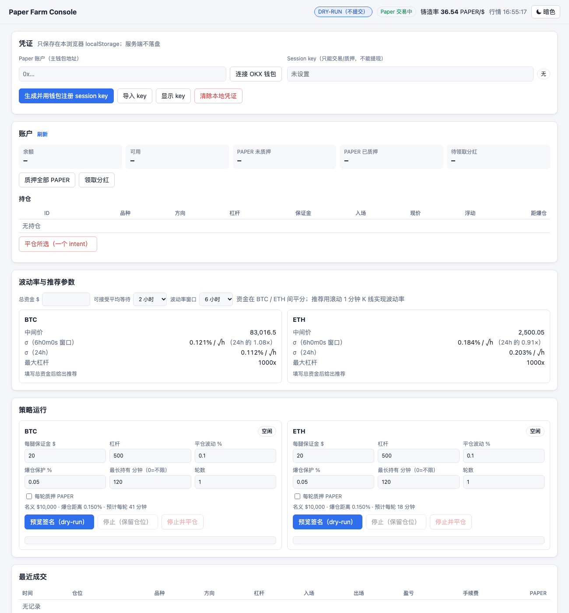
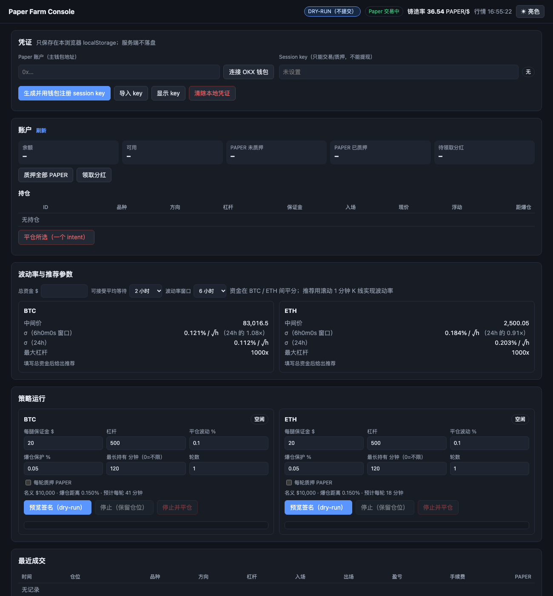

# alphafox-hedge-trader

**Farm PAPER on [Papertrade](https://exchange.papertrade.xyz) with delta-neutral long + short pairs — from a local web console that picks your leverage and close move from live volatility.**

[中文说明](#中文说明)

| Light | Dark |
|---|---|
|  |  |

## Why

Papertrade is a *loss-mining* perp on HyperEVM: every trade settles against the LP at the Hyperliquid BBO mid, and **the losing side mints PAPER** in proportion to its loss, while the winning side pays a 2% fee plus a move-dependent haircut. PAPER stakers receive the protocol's revenue.

So open an equal **long and short on the same account**, wait for the price to move, and **close both legs in one intent**. The loser mints PAPER; the winner hands back most of that loss. Your net cost is only the haircut + fee — and it depends on *how far price moved*, not on position size:

| Close move (BTC) | Cost per PAPER* |
|---|---|
| 0.03% (1000x, $20 account) | ~$0.014 |
| 0.1% | ~$0.0077 |
| 0.5% | ~$0.0043 |
| 1% | ~$0.0038 |

<sub>*At the 2026-10-11 mint rate of 36.8 PAPER per $1 of loss. ETH costs about 10% more at the same move. The full derivation from on-chain parameters is in [`docs/paper-research.md`](docs/paper-research.md) (Chinese).</sub>

Bigger moves are cheaper per PAPER but take longer to happen, and the move you wait for has to fit inside the bust distance (≈ 1/leverage). Choosing those numbers well is what this tool does.

## What's inside

- **Web console** (`hedgectl web`), a local single-page app:
  - **Rolling realized volatility** from Hyperliquid 1-minute candles (1h / 6h / 24h / 3d windows).
  - **Parameter recommendations** for BTC and ETH from your capital and how long you're willing to wait per cycle:
    - close move = σ·√wait;
    - bust guard = max(5 bp, 6σ·√10s);
    - leverage = the highest venue tier whose bust distance still covers move + guard.
    - It also shows expected cycle time, cost/PAPER and PAPER/hour, and tells you when capital is too small.
  - **One-click runs** per symbol: BTC and ETH can run in parallel. Each run shows live logs, net cost and PAPER minted, with stop or stop-and-close.
  - **Wallet flow**: connect OKX (or any injected EVM wallet), generate a session key, and sign `RegisterSessionKey`. You can also close positions, stake all, or claim dividends.
  - Light / dark theme.
- **Farm engine** (`pkg/farm`) with tested safety invariants:
  - It refuses to start unless the symbol is flat.
  - A one-legged open is closed immediately.
  - Both legs always close in a single intent, retried until confirmed.
  - The bust guard closes before liquidation.
  - Cancelling never leaves an unlogged position.
- **Papertrade gateway** (`pkg/paper`), reverse-engineered from the official frontend and pinned by golden tests against real on-chain intents:
  - EIP-712 intents: Open / Close / Stake / Unstake / Claim / RegisterSessionKey;
  - intent ids, nonces;
  - relayer submit, wallet SSE, trade history, and the mint curve.
- **Hyperliquid client** (`pkg/hyperliquid`): L1 action signing checked against the official Python SDK, plus orders, cancels, leverage, l2Book, mid and candles.
- **CLI** (`hedgectl`) for everything above.

## Quick start

Requires Go 1.25+.

```bash
go install github.com/alphafoxai/alphafox-hedge-trader/cmd/hedgectl@latest

hedgectl web           # http://127.0.0.1:8547 — DRY RUN: intents are signed and shown, never posted
hedgectl web -live     # posts intents for real
```

1. Deposit USDC on [Papertrade](https://exchange.papertrade.xyz). The minimum position is $10 margin and $10,000 notional per leg, so a pair needs at least $20 at 1000x; more capital allows lower leverage and cheaper PAPER.
2. In the console, connect your wallet and click **生成并用钱包注册 session key** (generate & register a session key). Your wallet signs one `RegisterSessionKey` message.
3. Enter your capital and acceptable wait, apply the recommendation, and start.

CLI equivalents: `hedgectl paper status | econ | account | trades`, `hedgectl farm run …`. Run `hedgectl` to see every command.

## Security model

- **Your master key never touches this tool.**
  - The master wallet signs exactly one thing, `RegisterSessionKey`, inside your own wallet.
  - Trading uses a Paper **session key**. It can trade and stake but **cannot withdraw**, and it expires after at most 30 days.
- **Credentials stay in your browser.**
  - The account address and session key live in `localStorage`.
  - The local server never writes them to disk; it holds a key in memory only while a run is active.
- **The console is local-only.**
  - It binds to loopback only and checks the Host header (DNS-rebinding defense).
  - Every API call needs a per-process random token embedded in the page (CSRF defense).
  - A local server is needed at all because the Papertrade relayer rejects cross-origin browser requests.
- **Everything is dry-run by default**; `-live` is opt-in.

## Risks — read before using real money

- This is **experimental, unaudited software** and is not affiliated with Papertrade. The wire format is reverse-engineered and may break when Papertrade changes it.
- **Losses are possible:**
  - liquidation if price gaps through the bust guard (hard liquidation forfeits the whole margin);
  - relayer or queue delays;
  - one leg failing to open;
  - rule changes, since the contracts are upgradeable.
- **PAPER is currently non-transferable**; its value comes only from staking dividends. Hedged farming is close to zero-sum across all farmers: long-run dividends per PAPER tend toward the farming cost per PAPER, and the mint rate only goes down over time.
- Nothing here is financial advice. Start with dry-run, then the minimum size.

## Development

```bash
go test -race ./...
```

All tests are offline:
- Papertrade wire formats are pinned by on-chain golden intents.
- Hyperliquid signing is pinned by vectors from the official SDK.
- The relayer and Hyperliquid are faked with httptest.
- The farm runs against a fake exchange and clock.

Integration notes: [`docs/paper-integration.md`](docs/paper-integration.md).

---

## 中文说明

**用同账户多空对冲在 Papertrade 上低成本挖 PAPER，附带本地 Web 控制台：按实时波动率推荐杠杆、平仓波动和爆仓保护。**

- **原理**：Paper 是「亏损挖矿」永续，亏损方按亏损额铸造 PAPER，盈利方被收 2% 手续费和冲击折扣。同一账户开等额多空，价格移动后用一个 intent 同时平两腿，净成本只有折扣加手续费。每 PAPER 成本只取决于平仓时的价格波动幅度，与仓位大小无关：BTC 0.1% 约 $0.0077，0.5% 约 $0.0043。
- **控制台**：`hedgectl web`，默认 dry-run，`-live` 才提交。
  - 从 Hyperliquid 1 分钟 K 线计算滚动波动率 σ。
  - 按资金和可接受的等待时间，推荐 BTC 和 ETH 各自的杠杆、平仓波动、爆仓保护，以及预计耗时、成本和每小时 PAPER 产出。
  - 一键运行，两个品种可并行；支持停止、停止并平仓、质押、领取分红，有亮色和暗色主题。
- **安全**：
  - 主钱包只在自己的钱包里签一次 `RegisterSessionKey`。
  - 交易用的 session key 只能交易和质押，不能提现，只存在本浏览器 localStorage。
  - 本地服务只监听 loopback，校验 Host 和随机 token。
- **风险**：实验性软件，未经审计，与 Papertrade 官方无关。可能因爆仓、单腿成交、规则变更而亏损。PAPER 目前不可转让。不构成投资建议，请先用 dry-run 和最小仓位试。
- 详细机制与成本推导见 [`docs/paper-research.md`](docs/paper-research.md)。
